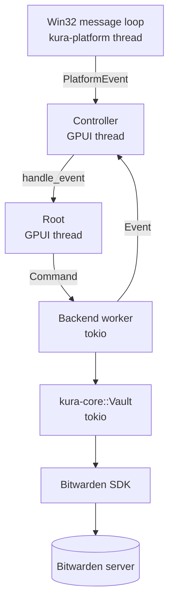
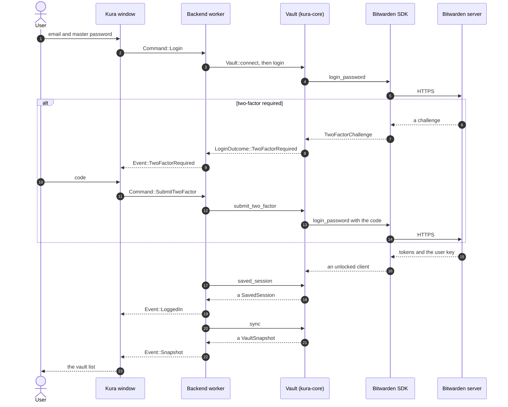

# Kura Architecture

Kura is a native Windows Bitwarden client written in Rust
([repository](https://github.com/hu-ja-ja/kura)). It keeps the Bitwarden SDK
as the vault engine and replaces the Electron shell with
[GPUI Kit](https://crates.io/crates/gpui-kit), the component kit on top of
GPUI.
This document is the map: where the SDK sits, which crate owns what, how the
UI reaches the network without waiting, and which invariants span the system.

New to the codebase? Read At a Glance, SDK Boundary, and Runtime Model first.
The rest is reference.

Module-level comments are the detailed reference for each file. This document
covers the boundaries between them. When a boundary changes, update this file
in the same change.

Diagrams are for relationships a table cannot show. Do not add one just to
decorate. If you move a crate boundary, a thread, or a channel, update the
diagram in the same change.

## Snapshot

This table is the state this document describes. If the code has moved on,
check it against `Cargo.toml` and `Cargo.lock` before trusting the details.

| Item | Value |
| --- | --- |
| Code state | commit [`ffe7203`](https://github.com/hu-ja-ja/kura/commit/ffe7203), 2026-11-08 |
| Workspace version | `0.1.0` |
| UI | [GPUI Kit](https://crates.io/crates/gpui-kit) `0.9` |
| Bitwarden SDK | [`sdk-internal` at `365fb98`](https://github.com/bitwarden/sdk-internal/tree/365fb983883370bfd2f6c3f3f51759634c7bf7b0), pinned in `crates/kura-core/Cargo.toml` |
| Platform | Windows 10 22H2 and Windows 11, x64 only |

## Overview

### Purpose

- A native Windows client for Bitwarden vaults.
- Small resident memory: no Electron, Node, Chromium, or WebView2 process.
- Fast startup, search, and scrolling compared with the Electron client.

### What This Document Covers

- Crate boundaries and the SDK wrapper.
- The runtime model and the channels between threads.
- The data flows through login, sync, detail, and lock.
- Persistence, security invariants, and the threat model.
- The update path and the release tooling.

Product scope and the roadmap live in [要件/要件.md](要件/要件.md); usage and
the feature overview live in [README.md](README.md) and
[README.ja.md](README.ja.md).

### Architecture Non-Goals

- Reimplementing the Bitwarden SDK.
- Guaranteeing feature parity with Bitwarden Desktop.
- Tracking upstream changes: this is a hard fork with a pinned SDK revision.

## At a Glance: Where the SDK Is

If you remember one thing: the UI never talks to Bitwarden. It sends a
command to the worker, the worker asks `kura-core`, and `kura-core` is the
only crate that depends on the SDK.

The one rule: only `kura-core` depends on `bitwarden-*`. Every other crate
names Kura types.

| Layer | Crates and modules | Touches the Bitwarden SDK? |
| --- | --- | --- |
| UI | `kura-app`: `app/`, `list.rs`, `detail.rs` | No |
| Bridge and lifecycle | `kura-app`: `backend.rs`, `controller.rs` | No |
| Vault engine | `kura-core` | Yes, the only place |
| Platform | `kura-platform` | No |
| Distribution | `kura-dist` | No |

Two public items in `kura-core` expose SDK value types:

- `SavedSession` carries `UserId`, `AuthenticationTokens`,
  `WrappedAccountCryptographicState`, and `MasterPasswordUnlockData` in its
  public fields. It is the serialized handoff back to the SDK: the app stores
  it, checks its email and endpoints, and passes it back, but never reads the
  SDK-typed fields. It is the one SDK-typed value the UI handles.
- `kura_core::client_settings` returns `ClientSettings`. The app does not use
  it; the vault engine and its tests do.

Apart from `SavedSession`, the UI names only Kura types: `Vault`,
`VaultSnapshot`, `VaultItem`, `VaultItemDetail`, `LoginOutcome`,
`TwoFactorChallenge`, `CoreError`.

## Layer Architecture

```text
kura-app
├── kura-core      -> Bitwarden SDK -> Bitwarden server
├── kura-platform  -> Windows APIs
└── kura-dist      -> update feed / Inno Setup
```

Only the `kura-core` branch depends on the SDK. Every other branch talks to
Kura types or to the operating system.

| Crate | Role | Main dependencies |
| --- | --- | --- |
| `kura-app` | Binary `kura`. GPUI Kit views, window controller, backend worker, settings, saved login file, clipboard, logging, update service and update window. | `kura-core`, `kura-platform`, `kura-dist`, `gpui-kit` |
| `kura-core` | UI-independent vault engine. Resolves server URLs, wraps the SDK, defines the saved session, maps SDK errors, and exposes the shapes the UI renders. No file I/O and no UI. | `bitwarden-*`, tokio, serde, url, zeroize |
| `kura-platform` | Win32 boundary: tray icon and menu, single-instance guard, idle and session-lock detection, suspend notification, autostart, window capture protection, DPAPI sealing, crash dump hardening. | `windows-sys`, tokio sync, zeroize |
| `kura-dist` | Update engine plus the release CLI. Verifies the signed manifest, downloads and hashes the installer, and starts Inno Setup. The binary half never ships with the app. | ed25519-dalek, blocking reqwest, rustls, sha2 |

### Dependency Rules

- Dependencies point inward. `kura-core`, `kura-platform`, and `kura-dist`
  never depend on `kura-app`.
- The three libraries are siblings; none depends on another.
- `kura-core` knows nothing about GPUI, Win32, or where files are stored.
- `kura-platform` knows nothing about the vault or the SDK.
- `kura-dist` knows nothing about the vault or the SDK.
- Async SDK work lives in `kura-app` (worker) and `kura-core` (SDK calls).
  `kura-platform` uses tokio only for its event channel.
- Unsafe code is confined to `kura-platform` (`windows.rs`, `dpapi.rs`,
  `crash.rs`). The workspace forbids it everywhere else.

## SDK Boundary: `kura-core`

### What `Vault` Owns

`Vault` holds one `PasswordManagerClient`, one `SyncClient`, and the identity
and API endpoints it was built for. A `Vault` belongs to one account and one
server; switching either builds a new one.

### Login and Two-Factor

- `Vault::connect` turns the user's server URL into `ClientSettings`, then
  builds the `PasswordManagerClient`.
- `Vault::login` calls `auth().login_password` with a 30-second deadline and
  returns either `LoggedIn` or `TwoFactorChallenge`.
- Authenticator and email are supported. A challenge with neither returns
  `TwoFactorUnsupported`; the app does not silently try another method.
- `Vault::send_email_code` asks the server to mail a code.
- A login that is authenticated but has no user key returns `KeyNotLoaded`
  instead of letting every later call fail with a less useful error.

### Saved Session and Unlock

`SavedSession` is the handoff between runs:

- authentication tokens,
- the wrapped account cryptographic state,
- the master-password-wrapped user key and its KDF (key derivation function)
  parameters,
- the identity and API endpoints.

`Vault::restore` installs the tokens into the SDK state, initializes user
crypto with `InitUserCryptoMethod::MasterPasswordUnlock`, and restores the
`USER_LOGIN_METHOD` that `initialize_user_crypto` overwrites with an empty
client id. The refresh request needs the password login method.

`Vault::saved_session` derives the master key again after a sign-in, wraps the
user key, and collects the private key and login method. `update_saved_tokens`
copies renewed tokens back into the saved session. The file itself is DPAPI
sealed by `kura-app`; `kura-core` only produces and accepts the struct.

### Sync

The SDK revision registers sync handlers for folders, Send, and policies, but
not for ciphers (vault items). `kura-core` therefore keeps one `SyncClient`
and registers handlers itself:

- `FolderSyncHandler` from the SDK,
- `CipherSyncHandler`, which stores the ciphers from the sync response.

`PasswordManagerClient::new_with_sync` cannot be used because it registers the
handlers on a `SyncClient` that is dropped before the call returns.

The crypto sync handler is omitted on purpose: it needs a host `StateBridge`
(the SDK's interface for host-owned local state) that a native Rust host does
not have in this revision. The client is already unlocked by the login, so the
vault works without it. Server-side key rotations are applied on the next
login.

`Vault::sync` uses a 60-second deadline and excludes equivalent subdomains
because Kura does not match them.

### Reads

- `snapshot` lists the vault, decrypts list fields, drops deleted items, and
  returns every folder it can read. A folder failure must not hide the list.
  Items that cannot be decrypted are counted, not fatal.
- `detail` decrypts one item by id and maps it to `VaultItemDetail`.
- `totp` generates the current code from the stored seed without returning the
  seed.
- `password` returns a `Zeroizing<String>` for the list's copy button.

### Error Mapping

SDK errors become `CoreError` before they leave the crate. The UI never names
an SDK error type. `CoreError::Internal` carries a static step label for the
log and never server text or a vault value. `Rejected` and `Server` keep the
server's own message for display.

## Runtime Model

### Threads and Executors

| Executor | Owns | Never does |
| --- | --- | --- |
| GPUI main thread | All UI entities, rendering, input, window controller | Network calls, key derivation, long file I/O |
| tokio multi-thread runtime | Backend worker, SDK network and decryption, one background sync at a time | Touch UI state directly, render |
| `kura-platform` thread | Win32 message loop, tray, idle timer, session and power notifications | Read the vault |
| GPUI background executor | Update check/download, clipboard timer, TOTP countdown, window restore delays | Decrypt vault items |

`main` leaks the tokio runtime because the platform launch closure is dropped
as soon as it has run. The runtime has to outlive it.

The diagram below is the same model as a picture. Read it top to bottom: a
platform event enters the controller, the command path runs down to the
server, and the worker returns events up the right side. `UpdateService`
also lives on the GPUI thread and sends `Request` to the controller; the
table below includes it.



The worker is the only path from the UI to the SDK. The UI thread never waits
on the network.

### Message Flow

| From | To | Message |
| --- | --- | --- |
| `Root` (UI) | backend worker | `Command` |
| backend worker | `Controller` | `Event` |
| tray thread | `Controller` | `PlatformEvent` |
| `UpdateService` | `Controller` | `Request` |
| window close hook | `Controller` | `WindowId` |

The controller passes backend events to `Root::handle_event`. The UI never
awaits the network; it sends a command and repaints when the event arrives.

- `Backend` is the only handle the UI needs: it sends `Command` and exposes
  `cancel`, `lock`, and `is_unlocked`.
- `Event` carries snapshots, detail, TOTP, failures, and lifecycle results.
- `Notify` wakes a worker that is waiting on the network so a lock does not
  wait for the request to finish.
- `unlocked` is an `AtomicBool` read when a window is recreated after sitting
  in the tray.

### Window and Process Lifecycle

- `main` loads settings and the saved login, starts the tray and single-instance
  guard, builds the tokio runtime, spawns the backend, then runs GPUI.
- `Controller` owns the backend, the platform handle, the clipboard guard, the
  update service, the vault window, and the update window. `Root` is the
  window content and is recreated when the window is recreated.
- Closing the window is a trip to the tray. If the login is unfinished, the
  backend is cancelled and the password is dropped. With `destroy_on_hide`,
  the window is destroyed, the renderer goes headless, and the working set is
  trimmed after the renderer has released its resources.
- Showing from the tray reuses the window when it still exists; otherwise it
  builds a new `Root` from settings and the saved login. An unlocked backend
  answers with `Command::Snapshot`.
- Quitting clears the clipboard, installs a staged update if one exists, and
  lets the normal quit path close the app. `QUITTING` prevents the close
  handler from turning shutdown into another trip to the tray.
- Locking can come from the UI, the tray, the idle timer, a Windows session
  lock, or suspend. The worker drops the keys, the controller clears the
  clipboard, and the UI drops decrypted state.

## Data Flows

### First Sign-In

The window sends a command; the worker signs in through `kura-core`; the SDK
talks to the server; the worker saves the session, syncs, and returns events.
The diagram below adds the two-factor branch.



For a custom server, the master password hash leaves the machine only after
the server has been shown to the user and approved. Official servers skip the
prompt. The approval is remembered in `settings.json`; it is a usability
guard, not a seal.

### Saved-Login Restore

1. `session::load` reads the sealed file and DPAPI unseals a `SavedSession`.
2. The controller fills the email and server fields. When the master password
   is entered, the UI sends `Command::Login`.
3. The worker reuses a retained locked `Vault` if it owns the session, or calls
   `Vault::restore` with the saved endpoints.
4. The retained list is published first, then a background sync runs.

The unlock itself needs no network and no second factor. The tokens and keys
are already in the file; the master password only unwraps the user key. The
background sync in step 4 does use the network.

### Sync

- After login or restore: `sync_and_publish`.
- Manual: `Command::Sync` with `force = true`.
- Timer: every 15 minutes while unlocked, through `spawn_sync`. One sync runs
  at a time; the next tick is skipped rather than queued.
- Window shown: `Command::Refresh`, which keeps the current list visible until
  the answer arrives.
- `finish_sync` ignores a result for a vault that was replaced while the
  request ran, persists renewed tokens, and publishes only when something
  changed. A rejected token after an unlock sends the user back to the login
  form.

### Detail, TOTP, and Password

- `Command::Detail`, `Command::Totp`, and `Command::CopyPassword` decrypt one
  item on demand.
- The UI keeps the decrypted detail only while the dialog is open. Closing the
  dialog or locking clears the item, rows, notes, and revealed fields.
- The TOTP countdown ticks once a second and asks for a fresh code at zero. A
  failed refresh retries after five seconds instead of freezing on a stale
  code.
- Copying puts the value on the clipboard and starts the wipe timer.

### Lock

1. A manual lock, tray action, idle timer, session lock, or suspend sends
   `Command::Lock`.
2. A pending second factor drops the password and the session.
3. Otherwise the worker saves renewed tokens and calls `Vault::lock`, which
   drops the keys.
4. `Event::Locked` makes the controller clear the clipboard and the window drop
   its decrypted state.

The encrypted ciphers stay in the SDK state after a lock. The next unlock with
the saved login can show them again before the next sync. If no saved login
matches the retained vault, the session is dropped instead.

## Persistence & Secrets

| Path | Contents | Protection | Writer |
| --- | --- | --- | --- |
| `%APPDATA%\Kura\settings.json` | Preferences, confirmed servers, window placement. No secrets. | Atomic write through a temp file and rename. | `settings.rs` |
| `%APPDATA%\Kura\session.bin` | `SavedSession`: tokens, wrapped crypto state, master-password-wrapped user key, endpoints. | Windows DPAPI, current user only, entropy `Kura saved login v1`; temp file plus rename. | `session.rs` |
| `%APPDATA%\Kura\update.json` | Update preferences: auto check, auto install, skipped version, reminder, last check. Kept separate so the main window and the update service never overwrite each other. | Atomic JSON write. | `update.rs` |
| `%LOCALAPPDATA%\Kura\logs\kura.log` | Rolling log, 1 MB, two files. Static text, paths, versions, error codes. | Profile paths redacted; no secrets. | `logging.rs` |
| `%LOCALAPPDATA%\Kura\updates\` | Downloaded installer staging. | SHA-256 and Ed25519 checks before use. | `update.rs` / `kura-dist` |

Never persisted: master password, unwrapped keys, decrypted items, TOTP seeds,
clipboard contents. There is no offline vault cache yet; every unlock syncs.

## Security Invariants

- Vault servers are HTTPS only; plain HTTP is refused even in debug builds. A
  saved session's endpoints are re-checked when they are read back.
- A custom server must be approved before the master password hash is sent.
  Changing the host or path asks again; `confirmed_servers` is a usability
  guard, not a cryptographic seal.
- The saved login is sealed with the Windows Data Protection API
  ([DPAPI](https://learn.microsoft.com/en-us/windows/win32/api/dpapi/nf-dpapi-cryptprotectdata))
  to the current Windows user. The file is safe against another account, a
  backup, or another machine, not against code already running as the user.
- Passwords, notes, card numbers, SSNs, SSH private keys, and custom field
  values are wrapped in `Zeroizing`. The decrypted detail is dropped when the
  dialog closes or the vault locks.
- Crash dumps are disabled before the vault can open. Logs, crash reports, and
  settings never contain a password, token, email, item value, or server
  response body.
- Clipboard text is written with the formats that opt out of clipboard history
  and cloud sync. It is wiped after the configured delay, on lock, and on quit,
  and only while the clipboard still holds Kura's value.
- Capture protection uses
  [`SetWindowDisplayAffinity`](https://learn.microsoft.com/en-us/windows/win32/api/winuser/nf-winuser-setwindowdisplayaffinity)
  with `WDA_EXCLUDEFROMCAPTURE`, and can be turned off in settings.
- Opening a URI allows only `http` and `https`, and rejects credentials in the
  URL.
- Update manifests are signed with Ed25519, installers are checked with
  SHA-256, the feed is HTTPS, redirects are bounded, and the manifest and
  artifact sizes are capped.
- One process. No Electron, Node, Chromium, or WebView2.

## Threat Model

The controls above answer specific threats. They do not make Kura a sandbox
against code that already runs as the same Windows user.

| Threat | What protects it | What it does not cover |
| --- | --- | --- |
| Another Windows account, a stolen disk, or a backup | DPAPI binds `session.bin` to the current user. Settings and logs hold no secrets. | A process running as the same user can unseal the file and read process memory. |
| Malware running as the same user | Crash dumps are disabled, secrets are zeroized, the clipboard is wiped, and no plaintext vault cache exists. | Same-user code can read memory, hook the UI, or read the clipboard before the wipe. |
| A stolen or lost device | Windows account protection and DPAPI protect the saved login at rest. | An attacker who can log in as the user, or attack the Windows account offline, is out of scope. |
| A malicious or compromised self-hosted server | HTTPS is required, the server must be approved before the master password hash is sent, and saved endpoints are re-checked. | An approved server sees the master password hash and the vault traffic. TLS termination is trusted. |
| A compromised update feed or signing key | Ed25519 verifies the manifest, SHA-256 verifies the installer, the feed is HTTPS, and redirects and sizes are bounded. | A stolen signing key, or a local attacker who replaces the installer after staging, is out of scope. The installer is not Authenticode-signed. |
| Accidental screen capture or screen sharing | `SetWindowDisplayAffinity(WDA_EXCLUDEFROMCAPTURE)` keeps the window out of captures on Windows 10 2004 and later. | Software that ignores the API, or a camera pointed at the screen, is out of scope. |

## Update & Distribution

Two layers, one responsibility each:

- `kura-app::update::UpdateService` owns the schedule (first check after ten
  seconds, then every 24 hours), the user's preferences, the state the update
  window renders, download progress, and install-on-quit.
- `kura-dist` owns the engine: manifest parsing, Ed25519 verification, bounded
  HTTP fetch, SHA-256 verification, and starting the installer. The
  `kura-dist` binary builds and signs releases and never ships with the app.

The feed is [manifest.json](https://hu-ja-ja.github.io/kura/manifest.json).
The signing key comes from `ED25519_PUBLIC_KEY`; without it a development key
is used and a release build refuses to update itself. The installer is
[Inno Setup](https://jrsoftware.org/isinfo.php) 7.1.0, per-user, and unsigned.

Release tasks live in `mise.toml`: `mise run package` builds the installer,
`mise run release` creates a draft release, and `mise run licenses` regenerates
the bundled license list.

## Testing Seams

- `Backend::detached` and `Platform::detached` keep the UI runnable without a
  worker or a tray.
- UI tests drive a real headless GPUI window. Backend commands are dropped, so
  they cover labels, dialogs, filtering, and key handling only.
- `kura-dist` integration tests use a loopback HTTP feed.
- `--demo` opens a fictional vault in a debug build; the `screenshots` feature
  captures the client area for the README.
- `mise run lint` runs formatting and clippy. `cargo test` runs the workspace
  tests. `mise run audit` checks dependencies for advisories.

## Current Constraints

These are the limits of the code at the snapshot commit. The roadmap is in
[要件/要件.md](要件/要件.md); this section says what the limit is and what
would remove it.

### Upstream (Bitwarden SDK)

- The [SDK](https://github.com/bitwarden/sdk-internal) revision is pinned and
  its API is not public-use stable. Expect breakage on every upgrade.
- This revision has no cipher sync handler. `CipherSyncHandler` fills the gap;
  remove it when the SDK ships one.
- The crypto sync handler needs a host `StateBridge` that a native Rust host
  does not have. Server-side key rotation is applied on the next login.
- The identity client has no redirect policy. See Known Security Risks.

### Kura Implementation

- No offline vault cache. Every unlock syncs.
- The vault is read-only: items cannot be added, edited, or deleted.
- One account at a time.
- No custom CA certificates or client certificates.

### Known Security Risks

- A 307 or 308 from a self-hosted identity endpoint could resend the master
  password hash to the redirect target, because the SDK's identity client has
  no redirect policy. The API client is safe because `bitwarden-pm` supplies
  middleware that selects `Policy::none`. HTTPS and explicit server approval
  reduce the exposure; the real fix is SDK support.
- The installer is not Authenticode-signed. The Ed25519 manifest and SHA-256
  check protect the update path, not the first download from the release page.

### Planned Improvements

- Remove `CipherSyncHandler` and the manual handler registration when the SDK
  provides them.
- Apply server-side key rotation without a fresh login when the SDK exposes a
  host `StateBridge`.
- Add an encrypted offline cache (the M5 roadmap in
  [要件/要件.md](要件/要件.md)).

## Where to Look

Links are relative to the repository root.

| Concern | Files |
| --- | --- |
| App entry, logging, runtime, GPUI setup | [main.rs](crates/kura-app/src/main.rs), [logging.rs](crates/kura-app/src/logging.rs) |
| Window lifecycle, tray actions, update window routing | [controller.rs](crates/kura-app/src/controller.rs) |
| UI screens and dialogs | [app/mod.rs](crates/kura-app/src/app/mod.rs), [app/login.rs](crates/kura-app/src/app/login.rs), [app/vault_view.rs](crates/kura-app/src/app/vault_view.rs), [app/detail_view.rs](crates/kura-app/src/app/detail_view.rs), [app/settings_view.rs](crates/kura-app/src/app/settings_view.rs) |
| Vault list and virtual scrolling | [list.rs](crates/kura-app/src/list.rs) |
| Detail rows | [detail.rs](crates/kura-app/src/detail.rs) |
| UI-to-SDK bridge, commands, events, worker | [backend.rs](crates/kura-app/src/backend.rs) |
| Vault engine, login, restore, sync, lock | [vault.rs](crates/kura-core/src/vault.rs) |
| SDK models to Kura models | [model.rs](crates/kura-core/src/model.rs) |
| Search and filters | [search.rs](crates/kura-core/src/search.rs) |
| Server URL resolution | [server.rs](crates/kura-core/src/server.rs) |
| Error taxonomy | [error.rs](crates/kura-core/src/error.rs) |
| Cipher sync handler gap | [cipher_sync.rs](crates/kura-core/src/cipher_sync.rs) |
| Saved login file | [session.rs](crates/kura-app/src/session.rs), [dpapi.rs](crates/kura-platform/src/dpapi.rs) |
| Settings | [settings.rs](crates/kura-app/src/settings.rs), [json_file.rs](crates/kura-app/src/json_file.rs) |
| Clipboard | [clipboard.rs](crates/kura-app/src/clipboard.rs) |
| Tray, auto-lock, single instance, capture protection | [lib.rs](crates/kura-platform/src/lib.rs), [windows.rs](crates/kura-platform/src/windows.rs) |
| Crash dump hardening | [crash.rs](crates/kura-platform/src/crash.rs) |
| Update service and window | [update.rs](crates/kura-app/src/update.rs), [update_window.rs](crates/kura-app/src/update_window.rs) |
| Update engine and release tool | [kura-dist/src](crates/kura-dist/src/), [kura-dist.rs](crates/kura-dist/src/bin/kura-dist.rs) |
| Installer definition | [kura.iss](crates/kura-dist/inno/kura.iss) |
| UI tests and demo mode | [ui_test.rs](crates/kura-app/src/app/ui_test.rs), [demo.rs](crates/kura-app/src/app/demo.rs) |
| Build and release tasks | [mise.toml](mise.toml), [release.ps1](scripts/release.ps1) |

## Related Documents

- [README (English)](README.md)
- [README (Japanese)](README.ja.md)
- [Requirements (Japanese)](要件/要件.md)
- [Updates and distribution (Japanese)](要件/更新と配布.md)
- [GitHub repository](https://github.com/hu-ja-ja/kura)
