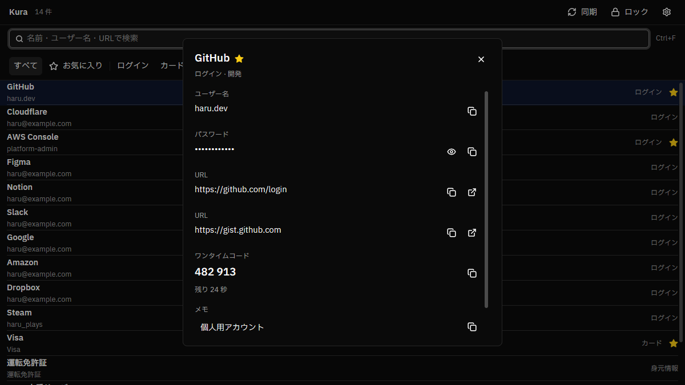

[English](README.md) | 日本語

# Kura

[](https://github.com/hu-ja-ja/kura/releases/latest)
[](LICENSE)

Windows用のネイティブBitwardenクライアントです。



## 機能

- **ログイン:** マスターパスワード、TOTPとメールの2段階認証、保存ログインでの解除。
- **保管庫:** 検索、フォルダ、お気に入り、項目の詳細。
- **操作:** 認証情報とTOTPのコピー、URIを開く操作。
- **アプリ:** トレイ、自動ロック、自動起動、二重起動の防止。
- **保護:** 保存ログインの保護、30秒後のクリップボード消去、画面キャプチャ保護。
- **更新:** 署名を検証するアプリ内更新。

## 動作環境

| 要件             | 対応                            |
| ---------------- | ------------------------------- |
| Windows          | Windows 10 22H2以降、Windows 11 |
| アーキテクチャ   | x64                             |
| 画面スケーリング | 100%から200%                    |
| 入力             | 日本語IME                       |

## ダウンロードとインストール

1. [Releases](https://github.com/hu-ja-ja/kura/releases/latest)から最新の`Kura-<version>-setup.exe`をダウンロードします。
2. インストーラを実行します。現在のユーザーにインストールされ、管理者権限は要りません。
3. インストール先を選びます。選択したフォルダの末尾に`Kura`が付きます。デスクトップショートカットは任意で、既定ではオフです。

インストーラは未署名のため、Windows SmartScreenの警告が表示されることがあります。

## 更新

起動10秒後と、その後は24時間ごとに自動で更新を確認します。手動でも確認できます。適用はKuraの終了時です。

## アンインストール

1. Windowsの設定 > アプリ > インストールされているアプリからKuraをアンインストールするか、インストール先の`unins000.exe`を実行します。
2. ユーザーデータを削除するか選びます。

   | 場所                  | 内容                         |
   | --------------------- | ---------------------------- |
   | `%APPDATA%\Kura`      | 設定、保存ログイン、更新設定 |
   | `%LOCALAPPDATA%\Kura` | ログ、ダウンロード済みの更新 |

Noを選ぶと、データを残したまま再インストールできます。

## ロードマップ

- [ ] アイテムを追加する
- [ ] アイテムの項目を編集する
- [ ] アイテムを削除し、ゴミ箱へ移動する
- [ ] 生体認証による解除ブリッジ
- [ ] 添付ファイル
- [ ] 保管庫データのインポート
- [ ] 複数アカウント
- [ ] 対応言語の拡大

## サポート

不具合や機能要望は[GitHub Issues](https://github.com/hu-ja-ja/kura/issues)へ報告してください。ログは`%LOCALAPPDATA%\Kura\logs`にあります。パスワード、トークン、保管庫の内容はログに記録されません。

## ソースからビルド

miseで開発ツールをインストールし、タスクを実行します。バージョンとチェックサムは`mise.lock`に固定されています。

```powershell
mise install
mise run run      # cargo run -p kura-app
mise run check    # cargo check --workspace --all-targets
mise run lint     # cargo fmt --check と clippy
mise run build    # リリースビルド
mise run package  # Inno Setupのインストーラ
```

`mise run package`はInno Setup 7.1.0を使い、`dist/Kura-<version>-setup.exe`とSHA-256ファイルを出力します。`mise run install-inno`でInno Setupをサイレントにインストールできます。

テストは`cargo test`、依存の脆弱性監査は`mise run audit`、同梱ライセンス一覧の再生成は`mise run licenses`で実行します。

開発ビルドは公開テスト鍵を使うため、更新のインストールを拒否します。

## クレート構成

| クレート        | 役割                                                                |
| --------------- | ------------------------------------------------------------------- |
| `kura-core`     | Bitwarden SDKを使うUI非依存の保管庫エンジン                         |
| `kura-app`      | GPUI Kitのアプリケーション                                          |
| `kura-platform` | Windowsのトレイ、二重起動、ロック検知、自動起動、画面キャプチャ保護 |
| `kura-dist`     | 更新エンジンとリリースツール                                        |

## ライセンス

- Kura: [GPL-3.0-only](LICENSE)。
- フォント: IBM Plex Sans JP、SIL Open Font License 1.1。詳細は`crates/kura-app/assets/fonts/license.txt`を参照してください。
- サードパーティ: `THIRD-PARTY-NOTICES.txt`を参照してください。依存ライブラリのライセンスは設定画面で確認できます。

## 補足

KuraはBitwarden SDKを使用する非公式クライアントです。Bitwardenとは関係ありません。
